# Asynchronous FIFO <!-- omit in toc -->

A parameterizable asynchronous (dual-clock) FIFO (First-In, First-Out) buffer implemented in Verilog/SystemVerilog with verification using SystemVerilog Testbench.

Clone the Repo:

```
git clone https://github.com/pletnevAE/FIFO_async.git
```

## Contents <!-- omit in toc -->

## Overview

The module implements an asynchronous FIFO bufferL the write port and read port work from two independent, unrelated clocks. It is designed for safe transfer of data streams between clock domains of FPGA-based digital systems.

Typical applications:

+ transfer of data between modules that work from different clock frequencies;
+ interfaces of ADCs, sensors and communication channels whose clock is not related to the clock of the processing logic;
+ buffering of bursty data with different write and read rates;
+ decoupling of pipeline stages and implementation of back-pressure in streaming interfaces between clock domains.

## Theoretical basis

### FIFO

A FIFO is a data buffer in which words are read in the same order in which they were written: the word written first is read first.

<p align="center">
  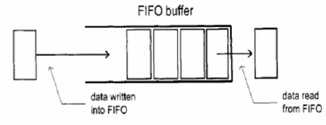
</p>

A FIFO has two independent sides:

+ the **write side** (producer), which puts words into the buffer;
+ the **read side** (consumer), which takes words out of the buffer;

Unlike an ordinary memory, a FIFO has no address inputs: the order of access is fixed by the FIFO itself.

A FIFO absorbs a temporary mismatch between the rates: the producer writes whenever it has data, the consumer reads whenever it is ready, and the FIFO fill level (the number of stored words, or *occupancy*) reflects the current difference between them.

Note that a FIFO only compensates a *temporary* mismatch. If the average write rate is permanently higher than the average read rate, a buffer of any finite size will sooner or later overflow.

### Circular buffer

Inside the FIFO the words are stored in a memory array of $D = 2^{\mathrm{ADDR\_WIDTH}}$ cells (the FIFO depth). The access order is controlled by two pointers:

+ **write pointer** - the address of the cell where the next written word will be placed;
+ **read pointer** - the address of the cell holding the oldest unread word.

On a write, the word is stored in the cell addressed by the write pointer, and the pointer is incremented. On a read, the word is taken from the cell addressed by the read pointer, and the pointer is incremented. After the last cell the pointers wrap around to the cell 0, so the memory behaves like a ring (circular buffer). The words are never moved inside the memory: only the pointers move.

<p align="center">
  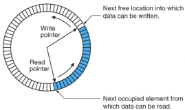
</p>

Consider the moment when both pointers point to the same cell. It can mean two opposite situations:

+ the FIFO is **empty**: the reader has caught up with the writer;
+ the FIFO is **full**: the writer has made a full lap and caught up with the reader.

Common ways to resolve this ambiguity:

1. keep a separate counter of stored words;
2. never fill the last cell (the FIFO is considered full when one free cell is left), which loses one cell of the capacity;
3. extend each pointer by one extra MSB.

This project uses the third option. The pointers are `ADDR_WIDTH + 1` bits wide:

+ the lower `ADDR_WIDTH` bits are the memory address;
+ the MSB is a "lap" bit: it toggles every time the pointer wraps around the end of memory.

Then:

+ the FIFO is **empty** if the pointers are completely equal (the same cell, the same lap);
+ the FIFO is **full** if the lower `ADDR_WIDTH` bits are equal, but the MSB differ (the same cell, but the writer is exactly one lap ahead).

The number of stored words is the difference of the pointers modulo $2^{\mathrm{ADDR\_WIDTH} + 1}$

```math
N = (\mathrm{wr\_ptr} - \mathrm{rd\_ptr}) \bmod 2^{\mathrm{ADDR\_WIDTH} + 1}, \qquad 0 \le N \le D
```

All $D$ cells of the memory are usable. The operation of a FIFO that works from a single clock is described in more detail in the README of the [synchronous FIFO](https://github.com/pletnevAE/FIFO_sync).

### Synchronous and asynchronous FIFO

+ **Synchronous FIFO** - the write and the read are performed on the same clock. It is used to buffer data inside one clock domain.
+ **Asynchronous FIFO** - the write and the read have different, unrelated clocks.

In an asynchronous FIFO the write pointer changes on write clock domain (`w_clk`), the read pointer changes on `r_clk`. But to determine whether the FIFO is empty, the read side has to compare the read pointer with the write pointer, and to determine whether the FIFO is full, the write side has to compare the write pointer with the read pointer. Therefore each pointer has to be passed to the other clock domain. This operation is called clock domain crossing (CDC), and it cannot be done by a simple wire.

<p align="center">
  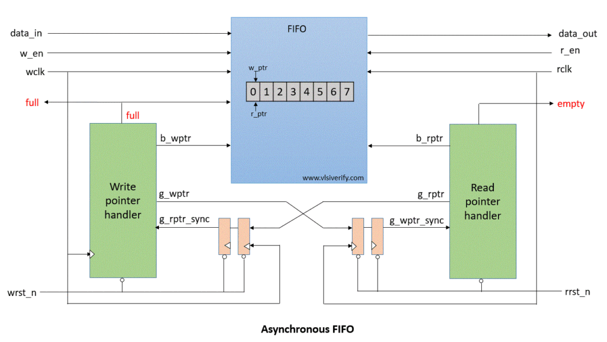
</p>

### Clock domain crossing and metastability

A flip-flop correctly captures a signal only if the signal is stable for a short time before and after the clock edge (setup and hold time). A signal that comes from a domain with an unrelated clock may change exactly in this window. In this case the flip-flop output becomes *metastable*: for an unpredictable time it stays at an intermediate level and then settles to a random value, 0 or 1. The longer the flip-flop has to settle, the lower the probability that it is still metastable.

<p align="center">
  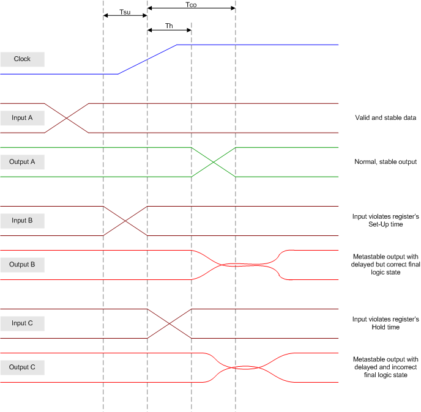
</p>

A multi-bit bus has a second problem. The bits of a bus never change at exactly the same moment (skew). If a binary counter changes from `0111` to `1000`, a flip-flop that samples the bus at this moment can capture a mix of old and new bits, for example `1111` or `0000`. Therefore, a binary pointer cannot be passed to another clock domain directly.

### Flip-flop synchronizer

A single-bit signal is passed to another clock domain through a chain of two (or more) flip-flops clocked by the destination clock:

<p align="center">
  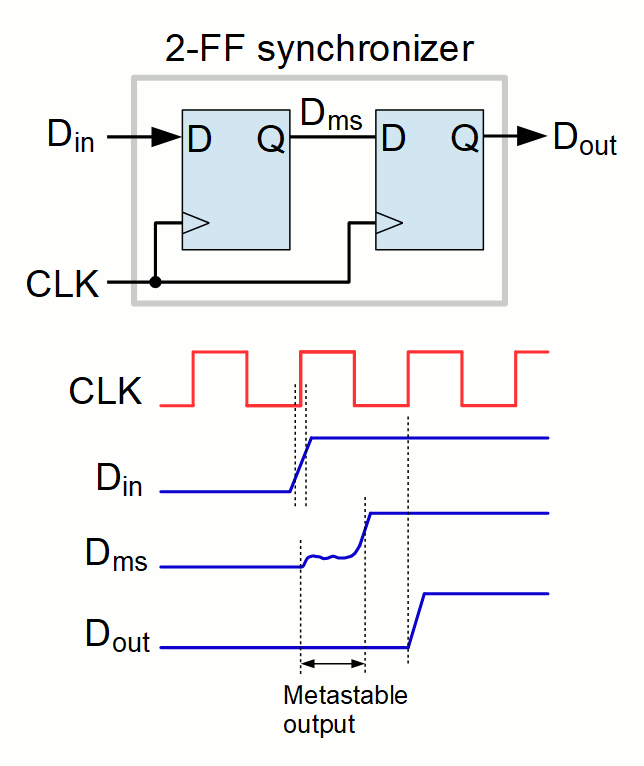
</p>

The first flip-flop may become metastable, but it has a whole clock period to settle before the second flip-flop captures its output. With a high probability the output of the second flip-flop is stable and correct. The price is the latency: the signal appears in the destination domain only 2 clock cycles later. The number of stages is set by the `SYNC_STAGES` parameter of the **synchronizer.sv** module. The input of the first flip-flop must be connected directly to a register of the source domain, without combinational logic in between.

### Gray code and pointers

Gray code is a code in which two consecutive values differ in exactly one bit (including the transition from the maximum value to zero). For 3 bits:

| Decimal | 0 | 1 | 2 | 3 | 4 | 5 | 6 | 7 |
| :--: | :--: | :--: | :--: | :--: | :--: | :--: | :--: | :--: |
| Binary | `000` | `001` | `010` | `011` | `100` | `101` | `110` | `111` |
| Gray | `000` | `001` | `011` | `010` | `110` | `111` | `101` | `100` |

The conversion from binary to Gray code and back:

$$G = B \oplus (B \gg 1),$$
$$B_{N - 1} = G_{N - 1},$$
$$B_i = B_{i + 1} \oplus G_i.$$

The pointer of each domain increments by one at most per clock cycle. If the pointer is Gray-coded, exactly one bit changes at each increment. Each domain stores its pointer in two forms:

+ **binary** - it is used to address the memory and to calculate the occupancy;
+ **Gray** - it is registered and passed to the other clock domain through the synchronizer.

The pointer that is seen in the other domain is always *outdated*: it is delayed by the synchronizer. If the source clock is faster than the destination clock, some intermediate values of the pointer are never seen in the other domain at all. It makes the view of the other domain older, but never wrong, because the pointers only move forward.

### Full and empty detection

The FIFO is **empty** if the read pointer is equal to the write pointer. The comparison is made in the read domain: the read Gray pointer is compared with the synchronized write Gray pointer.

The FIFO is **full** if the pointers are different only in the MSB (in binary form). The comparison is made in the write domain. Gray code is a reflected code, so the Gray code of the pointer that is exactly one lap ahead is equal to the Gray code of the other pointer with the **two upper bits inverted**:

```math
\mathrm{full} \iff \mathrm{w\_ptr} = \{\sim \mathrm{r\_ptr}[\mathrm{ADDR\_WIDTH}:\mathrm{ADDR\_WIDTH} - 1], \ \mathrm{r\_ptr}[\mathrm{ADDR\_WIDTH} - 2:0]\}
```

Example for `ADDR_WIDTH = 2` (depth $D = 4$, 3-bit pointers; synchronization delay is not taken into account in the table):

| Step | Operation | `w_bin` | `w_ptr` (Gray) | `r_bin` | `r_ptr` (Gray) | Words stored | State |
| :--: | :--: | :--: | :--: | :--: | :--: | :--: | :--: |
| 1 | Reset | `000` | `000` | `000` | `000` | 0 | empty (Gray pointers are equal) |
| 2 | 3 writes | `011` | `010` | `000` | `000` | 3 | - |
| 3 | 1 write | `100` | `110` | `000` | `000` | 4 | full (`110` = `000` with the two upper bits inverted) |
| 4 | 1 read | `100` | `110` | `001` | `001` | 3 | - (`001` with the two upper bits inverted is `111`) |
| 5 | 1 write | `101` | `111` | `001` | `001` | 4 | full (`111` = `001` with the two upper bits inverted) |
| 6 | 4 reads | `101` | `111` | `101` | `111` | 0 | empty (Gray pointers are equal) |

Since the pointer of the other domain is outdated, the flags are always **pessimistic**, but never **optimistic**:

+ the write side seed an outdated read pointer, so it considers the FIFO fuller than it is. After a read, `full` is deasserted with a delay, but it is never deasserted too early;
+ the read side sees an outdated write pointer, so ir considers the FIFO emptier than it is. After a write, `empty` is deasserted with a delay, but it is never deasserted too early.

Because of this, overflow and underflow are impossible: the price is only the latency of the flags.

### Status flags

+ `w_full` - the FIFO has no free cells. A write is not possible The flag belongs to the write domain.
+ `r_empty` - the FIFO has no stored words. A read is not possible. The flag belongs to the read domain.
+ `w_almost_full` - the number of stored words has reached a programmable threshold (`ALMOST_FILL_VAL`). It is an early warning; only a few free cells are left. The flag belongs to the write domain.
+ `r_almost_empty` - the number of stored words has dropped to a programmable threshold (`ALMOST_EMPTY_VAL`) or lower. It is an early warning: only a few words are left. The flag belongs to the read domain.

Each flag is generated in the clock domain of the side that uses it, so the producer works only with write domain flags, and the consumer only with the read domain flags. The flags do not require additional synchronization.

A write to a full FIFO would overwrite the oldest unread word (*overflow*), and a read from an empty FIFO would return meaningless data (*underflow*). Therefore, a correct FIFO ignores such operations, and the user is expected to monitor the flags.

The `w_almost_full` and `r_almost_empty` flags are calculated from the occupancy. In each domain the occupancy is the difference between the pointer of this domain (binary) and the synchronized pointer of the other domain converted from Gray code to binary. Since the pointer of the other domain is outdated, the write side overestimates the occupancy, and the read side underestimates it. Thus, `w_almost_full` and `r_almost_empty` are also pessimistic.

Latency of the flags (verified in simulation):

| Event | Flag | Latency |
| :--: | :--: | :--: |
| A write fills the FIFO | `w_full` is asserted | On the same `w_clk` edge, no extra latency |
| A read empties the FIFO | `r_empty` is asserted | On the same `r_clk` edge, no extra latency |
| A write into the empty FIFO | `r_empty` is deasserted | From 2 to 3 periods of `r_clk` after the write |
| A read from the full FIFO | `w_full` is deasserted | From 2 to 3 periods of `w_clk` after the read |
| Any change of the occupancy | `w_almost_full`, `r_almost_empty` | 1 clock cycle (the flag is registered) plus the delay of the pointer of the other domain |

The exact value of the delay from 2 to 3 periods depends on the phase relation between the clocks.

### Standard and First-Word Fall-Through

There are two conventions for reading from a FIFO:

+ **Standard read**: the consumer asserts the read request, and the requested word appears on the data output one clock cycle later.
+ **First-Word Fall-Through (FWFT, show-ahead)**: the oldest word is already present on the data output whenever the FIFO is not empty.

In the FWFT mode the consumer can look at the word before consuming it. This maps naturally onto streaming handshakes: `!r_empty` plays the role of "data is valid", and `r_en` plays the role of "data is accepted".

### Memory implementation

The memory of an asynchronous FIFO is a dual-port memory: the write port works from `w_clk`, the read port belongs to the read domain. The memory array can be implemented in two ways:

+ **in logic (flip-flops / distributed registers)** - flexible, any word can be read combinationally at any moment, but it consumes many logic resources as the depth grows; it is suitable for small FIFOs;
+ **in block RAM** (for example, M9K blocks of Intel MAX10) - efficient for large depths and wide words, but block RAM has a synchronous read (the read address is registered inside the block), which has to be taken into account in the read logic.

### FIFO depth and flag threshold

The minimum depth is determined by the worst-case burst. If a burst of $B$ words is written at one word per `w_clk` cycle, and during the burst the consumer reads at one word per `r_clk` cycle, then the FIFO has to be able to store at least

```math
D_{min} \approx B \cdot \left(1 - \frac{f_{\mathrm{r\_clk}}}{f_{\mathrm{w\_clk}}}\right)
```

words ($f_{r\_clk} < f_{w\_clk}$). For example, for $B = 64$, $f_{w\_clk} = 100$ MHz and $f_{r\_clk} = 45.45$ MHz: $D_{min} \approx 35$, therefore the next power of two should be chosen, $D = 64$. In practice, a margin is added, because the write side learns about the freed cells only 2-3 `w_clk` cycles after the read.

The thresholds of the `w_almost_full` and `r_almost_empty` flags depend on how quickly the neighbouring modules react. For `w_almost_full`, at least as many free cells should be reserved as the number of words that can still arrive between the moment the occupancy crosses the threshold and the moment the producer actually stops writing. This include the latency of the flag itself and the reaction time of the producer. The delay of the read pointer does not make the flag late, because it can only overestimate the occupancy. For `r_almost_empty` the same is true in the opposite direction: the flag can stay asserted for a few clock cycles after new words have been written, but it is never late.

### Timing constraints

The static timing analysis has to know that the clocks are unrelated, and the paths between the clock domains have to be constrained separately. In **FIFO_async.sdc**:

+ the clocks are described with `create_clock`, and `set_clock_groups -asynchronous` tells the analyzer that paths between the clock domains must not be analyzed as ordinary synchronous paths;
+ `set_max_delay` limits the delay of each bit of the Gray pointer to the first flip-flop of the synchronizer by one period of the destination clock. This limits the skew between the bits of the pointer;
+ resets are asynchronous, the paths from the reset ports are declared as false paths.

## Architecture

The FIFO is implemented as a top-level module **FIFO** (file **FIFO.v**) that instantiates the following modules:

<p align="center">
  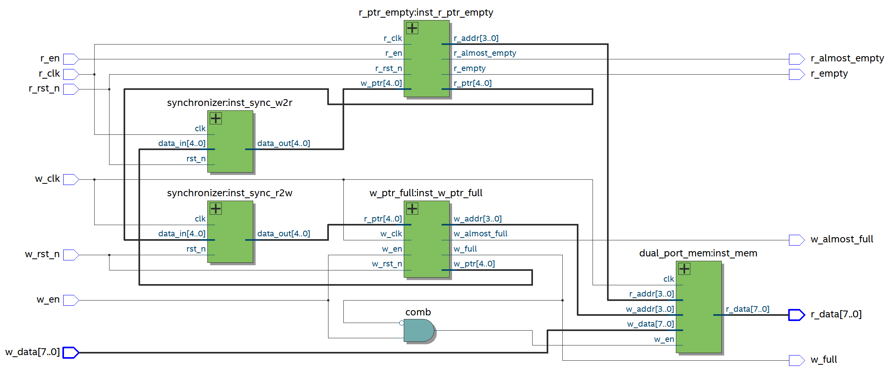
</p>

1. **Memory** (**dual_port_mem.sv**): a dual-port memory of $2^{\mathrm{ADDR\_WIDTH}}$ words of `DATA_WIDTH` bits. The write is synchronous (`w_clk`) and is performed when write enable signal is set and the FIFO is not full. The read is asynchronous: `r_data` always shows the word addressed by the read pointer, so the oldest word is always present on the output (FWFT). The memory type is set by the synthesis attribute `ramstyle` taken from the `MEM_STYLE` parameter.

    <p align="center">
      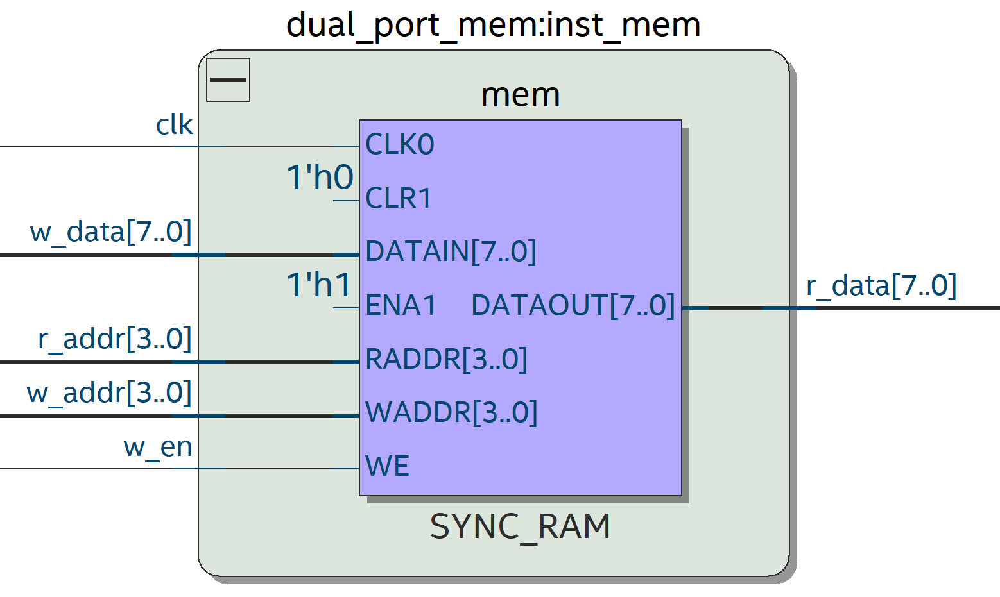
    </p>

2. **Write pointer and full logic** (**w_ptr_full.sv**, clock `w_clk`): the module keeps the write pointer in two forms: the binary pointer `w_bin` (`ADDR_WIDTH + 1` bits, its lower `ADDR_WIDTH` bits are the memory write address) and the Gray pointer `w_ptr`, which is registered and passed to the read domain. The pointer is incremented only when a write is accepted, that is, when `w_en = 1` and FIFO is not full.

    <p align="center">
      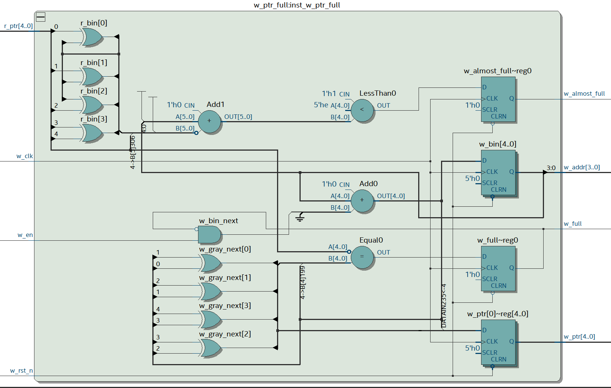
    </p>

    + **Full flag**: the Gray code of the *next* write pointer is compared with the synchronized Gray read pointer according to the rule described in [Full and empty detection](#full-and-empty-detection). Since the next value is used, `w_full` is set on the same clock edge as the write that fills the FIFO.
    + **Almost full flag**: the synchronized Gray read pointer is converted back to binary code, and the number of stored words is calculated as the difference between `w_bin` and the converted pointer. `w_almost_full` is set when this number reaches `ALMOST_FULL_VAL`. The current value of `w_bin` is used, so the flag lags by one clock cycle.
3. **Read pointer and empty logic** (**r_ptr_empty.sv**, clock `r_clk`): the module keeps the read pointer in two forms: the binary pointer `r_bin` (`ADDR_WIDTH + 1` bits, its lower `ADDR_WIDTH` bits are the memory read address) and the Gray pointer `r_ptr`, which is registered and passed to the write domain. The pointer is incremented only when a read is accepted, that is, when `r_en = 1` and the FIFO is not empty.

    <p align="center">
      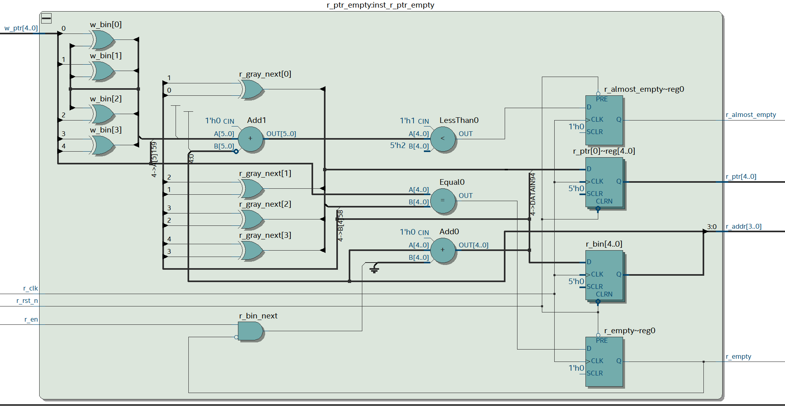
    </p>

    + **Empty flag**: the Gray code of the *next* read pointer is compared with the synchronized Gray write pointer, and the FIFO is empty if they are equal. Since the next value is used, `r_empty` is set on the same clock edge as the read that empties the FIFO.
    + **Almost empty flag**: the synchronized Gray write pointer is converted back to binary code, and the number of stored words is calculated as the difference between the converted pointer and `r_bin`. `r_almost_empty` is set when this number drops to `ALMOST_EMPTY_VAL` or lower. The current value of `r_bin` is used, so the flag lags by one clock cycle.
4. **Synchronizers** (**synchronizer.sv**): `inst_sync_r2w` passes the read Gray pointer to the write domain, `inst_sync_w2r` passes the write Gray pointer to the read domain.

<p align="center">
  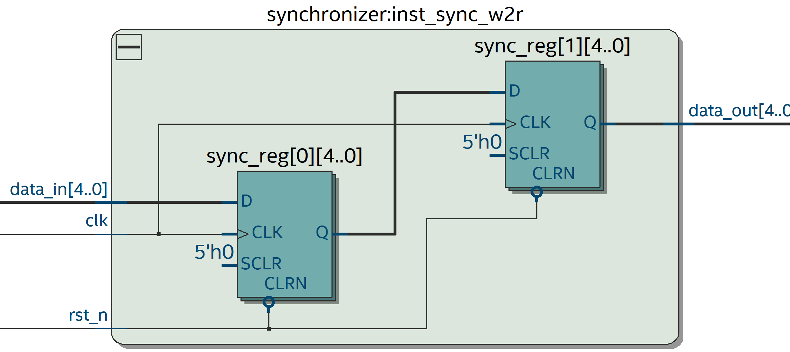
</p>

Operations are accepted only when they are possible: a write is ignored when `w_full = 1`, a read is ignored when `r_empty = 1`. Thus a write to a full FIFO and a read from an empty FIFO cannot corrupt the stored data or the pointers.

All four flags are registered. `w_full` and `r_empty` are calculated from the *next* values of the pointers, so they are updated together with the pointers, on the same clock edge. The flags `w_almost_full` and `r_almost_empty` are calculated from the current occupancy, so they lag by one clock cycle.

Each clock domain has its own asynchronous active-low reset. After reset the pointers are zero, `w_full = 0`, `w_almost_full = 0`, `r_empty = 1`, `r_almost_empty = 1`. The contents of the memory are not cleared. Both resets must be applied together: if only one domain is reset, the pointers of the domains become inconsistent. It is recommended to release each reset synchronously to the clock of its domain and to start the operation after both resets are released and the synchronizers are flushed.

Key implementation features:

+ two independent clock domains with asynchronous Active-Low resets;
+ parameterization of data width, depth, flag thresholds and memory type;
+ Gray-coded pointers and flip-flop synchronizers for safe clock domain crossing;
+ full/empty detection using pointers with an extra bit, without a separate counter; all $2^{\mathrm{ADDR\_WIDTH}}$ cells are usable;
+ First-Word Fall-Through read;
+ protection against overflow and underflow;
+ registered flags;
+ every flag is generated in the clock domain where it is used, the flags are pessimistic, but never optimistic;
+ memory type is selectable by synthesis attribute `ramstyle`.

## Interface

### Parameters

| Parameter | Default Value | Description |
| :--: | :--: | :--: |
| `DATA_WIDTH` | 8 | Input and output data width |
| `ADDR_WIDTH` | 4 | FIFO address width |
| `ALMOST_FULL_VAL` | $2^{\mathrm{ADDR\_WIDTH}} - 2$ | Number of stored words at which `w_almost_full` is asserted (occupancy $\ge$ value) |
| `ALMOST_EMPTY_VAL` | 2 | Number of stored words at which `r_almost_empty` is asserted (occupancy $\le$ value) |
| `MEM_STYLE` | "M9K" | Memory type: `"logic"` - flip-flops, `"M9K"` - block RAM of MAX10 |

### Signals

| Port | Direction | Width | Clock domain | Description |
| :--: | :--: | :--: | :--: | :--: |
| `w_clk` | Input | 1 | - | Write clock signal |
| `w_rst_n` | Input | 1 | `w_clk` | Asynchronous Active-Low Reset |
| `w_en` | Input | 1 | `w_clk` | Write enable signal |
| `w_data` | Input | `DATA_WIDTH` | `w_clk` | Input data |
| `r_clk` | Input | 1 | - | Read clock signal |
| `r_rst_n` | Input | 1 | `r_clk` | Asynchronous Active-Low Reset |
| `r_en` | Input | 1 | `r_clk` | Read enable signal |
| `r_data` | Output | `DATA_WIDTH` | `r_clk` | Output data |
| `w_full` | Output | 1 | `w_clk` | FIFO full flag |
| `r_empty` | Output | 1 | `r_clk` | FIFO empty flag |
| `w_almost_full` | Output | 1 | `w_clk` | FIFO almost full flag |
| `r_almost_empty` | Output | 1 | `r_clk` | FIFO almost empty flag |

## Utilization

The project was synthesized for the 10M50DAF484C6GES FPGA on the DE10-Lite board using Quartus 22.1 Standard Edition. Timing constraints are specified in **FIFO.sdc**: the write clock with the period of 10 ns (100 MHz), the read clock with the period of 22 ns (45.45 MHz), asynchronous clock groups, the maximum delay constraints of the pointer paths to synchronizers, automatically derived clock uncertainty, and the false paths from the `w_rst_n` and `r_rst_n` ports.

| FPGA | `DATA_WIDTH` | `ADDR_WIDTH` | `ALMOST_FULL_VAL` | `ALMOST_EMPTY_VAL` | `MEM_STYLE` | LUT | FF | Memory bits | $F_{max}$ `w_clk`, MHz | $F_{max}$ `r_clk`, MHz | Hold Slack, ns | Setup Slack, ns |
| :--: | :--: | :--: | :--: | :--: | :--: | :--: | :--: | :--: | :--: | :--: | :--: | :--: |
| 10M50DAF484C6GES | 8 | 4 | 14 | 2 | "M9K" | 73 | 53 | 128 | 252.08 | 234.08 | 0.224 | 6.033 |
| 10M50DAF484C6GES | 8 | 4 | 14 | 2 | "logic" | 234 | 160 | 0 | 247.22 | 278.24 | 0.323 | 5.955 |
| 10M50DAF484C6GES | 16 | 4 | 14 | 2 | "M9K" | 78 | 61 | 256 | 237.59 | 199.88 | 0.225 | 5.791 |
| 10M50DAF484C6GES | 16 | 4 | 14 | 2 | "logic" | 379 | 300 | 0 | 250.5 | 284.5 | 0.324 | 6.008 |
| 10M50DAF484C6GES | 16 | 8 | 254 | 2 | "M9K" | 135 | 93 | 4096 | 184.88 | 166.25 | 0.363 | 4.591 |
| 10M50DAF484C6GES | 16 | 8 | 254 | 2 | "logic" | 5167 | 4172 | 0 | 138.41 | 162.13 | 0.368 | 2.775 |

## Simulation

Simulation is performed in ModelSim 10.6d using the SystemVerilog testbench (**testbench.sv**). The testbench uses a reference model (scoreboard) of the FIFO - a SystemVerilog queue. The write and the read domains are driven independently, each from its own clock, and the phase of the read clock is shifted relative to the write clock. The stimulus of each domain is driven on the falling edge of the clock of this domain (the DUT samples stable values on the rising edge), and consecutive operations are issued in consecutive clock cycles without idle cycles in between (back-to-back).

The whole set of tests is executed twice:

+ **PASS 1**: the period of the write clock is `W_CLK_PERIOD` (10 ns), the period of the read clock is `R_CLK_PERIOD` (22 ns);
+ **PASS 2**: several words are written to the FIFO, then the FIFO is reset while it holds data, the clock periods are swapped (the write clock period is 22 ns, the read clock period is 10 ns), all tests are repeated.

| Parameter | Default value | Description |
| :--: | :--: | :--: |
| `W_CLK_PERIOD` | 10 | Write clock period in ns |
| `R_CLK_PERIOD` | 10 | Read clock period in ns |
| `R_CLK_OFFSET` | 3 | Read clock phase shift in ns |
| `RESET_CYCLES` | 10 | Number of clock cycles of each domain in reset |
| `SETTLE_CYCLES` | 6 | Number of clock cycles of each domain to wait until the flags settle |
| `FULL_ATTEMPTS` | 5 | Number of write attempts to the full FIFO |
| `EMPTY_ATTEMPTS` | 5 | Number of read attempts from the empty FIFO |
| `RAND_CYCLES` | 1000 | Number of clock cycles of the slower domain in each phase of the random test |
| `DATA_WIDTH` | 8 | Input and output data width |
| `ADDR_WIDTH` | 4 | Address width |
| `ALMOST_FULL_VAL` | $2^{\mathrm{ADDR\_WIDTH}} - 2$ | Almost full threshold |
| `ALMOST_EMPTY_VAL` | 2 | Almost empty threshold |
| `MEM_STYLE` | `"M9K"` | Memory type |

The testbench consists of five tests:

1. back-to-back writes until the number of stored words reaches `ALMOST_FULL_VAL`;
2. back-to-back writes until the FIFO is full, then `FULL_ATTEMPTS` write attempts to the full FIFO, which must be ignored;
3. back-to-back reads until `ALMOST_EMPTY_VAL` words are left;
4. back-to-back reads until the FIFO is empty, then `EMPTY_ATTEMPTS` read attempts from the empty FIFO, which must be ignored;
5. random reading and writing in both domains at the same time with random `w_en`, `r_en` and `w_data` in every clock cycle. The test consists of three phases of `RAND_CYCLES` clock cycles: balanced, write-heavy and read-heavy. The probabilities of the operations are scaled by the clock periods, so the throughputs of the phases do not depend on which of the clocks is faster.

After each test the operations are stopped, the testbench waits `SETTLE_CYCLES` clock cycles of each domain until the pointers pass through the synchronizers, and checks the flags at rest.

Because the pointers pass through the synchronizers, the flags are allowed to react with a delay while the FIFO is operating, so their exact values cannot be compared with the reference model in every clock cycle. Therefore the testbench checks:

1. in every clock cycle: match between `r_data` and the oldest word of the reference model for every accepted read (data integrity and order);
2. in every clock cycle: absence of overflow (a write is never accepted when the FIFO is full) and underflow (a read is never accepted when the FIFO is empty);
3. in every clock cycle: `w_full` is asserted when the FIFO is full. and `r_empty` is asserted when the FIFO is empty;
4. in every clock cycle: `w_almost_full` is asserted if the number of words in the reference model *before* the clock edge is not less than `ALMOST_FULL_VAL`, and `r_almost_empty` is asserted if it is not greater than `ALMOST_EMPTY_VAL`. It takes the one-clock-cycle latency of these flags into account;
5. at rest and in reset: all four flags are exactly equal to the values calculated from the number of words in the reference model, and `r_data` is equal to the oldest word.

Each mismatch is reported with the `$error` message and increases the error counter. At the end of the simulation the testbench displays the statistics of the transactions (the number of write and read attempts rejected because the FIFO was full or empty show that the boundary states were reached) and either a success message, or the total number of detected errors:

```
# STARTING TESTBENCH FOR ASYNCHRONOUS FIFO (DATA_WIDTH = 16, ADDR_WIDTH = 8, ALMOST_FULL_VAL = 254, ALMOST_EMPTY_VAL = 2)
# [0] PASS 1: write clock period = 10.0 ns, read clock period = 22.0 ns
# [531000] TEST 1: Writing to the FIFO before setting almost full
# [3259000] TEST 2: Writing to the FIFO before setting full
# [3501000] TEST 3: Reading from the FIFO before setting almost empty
# [9287000] TEST 4: Reading from the FIFO before setting empty
# [9639000] TEST 5: Random reading and writing
# [75837000] Statistics: writes accepted/rejected(full) = 514/2096, reads accepted/rejected(empty) = 258/6, max words in FIFO = 256
# [76079000] The FIFO holds 256 words, the reset will be applied now
# [76079000] PASS 2: reset, write clock period = 22.0 ns, read clock period = 10.0 ns
# [76615000] TEST 1: Writing to the FIFO before setting almost full
# [82405000] TEST 2: Writing to the FIFO before setting full
# [82755000] TEST 3: Reading from the FIFO before setting almost empty
# [85485000] TEST 4: Reading from the FIFO before setting empty
# [85745000] TEST 5: Random reading and writing
# [151995000] Statistics: writes accepted/rejected(full) = 512/2142, reads accepted/rejected(empty) = 256/5, max words in FIFO = 256
# [PASS] ASYNCHRONOUS FIFO MODULE TESTS PASSED!
```

In case of failure:

```
[FAIL] TESTS FAILED! <N> errors detected!
```

For a visual check of the module operation, it is also useful to examine the waveforms:

<p align="center">
  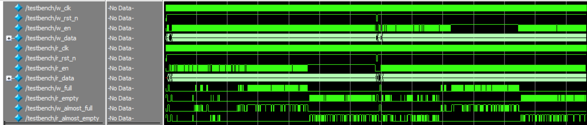
</p>

## Building the project out-of-the-box

Scripts **run_build.bat**, **build.tcl**, **timing.tcl** and **sim.tcl** are implemented for building the project out-of-the-box. The scripts perform project synthesis and fitting, Static Timing Analysis (STA) with the constraints from **FIFO.sdc**, and verification using a testbench. For the scripts to work, the path to the **bin64** folder within the Quartus root directory must be included in the `PATH` environment variable in Windows.

To run the script, you need to enter the following in the command line from the directory **tcl**:

```
run_build.bat <build_path> -DATA_WIDTH <value> -ADDR_WIDTH <value> -ALMOST_FULL_VAL <value> -ALMOST_EMPTY_VAL <value> -MEM_STYLE <string>
```

To get help on the script, you need to enter the following in the command line:

```
run_build.bat <build_path> --help
```

Setting the parameter flags is not necessary; if one of them (or all of them) is not set, the parameter will take on the default value.

The scripts output project build information, a Compilation Report, STA results and verification results to the console.
